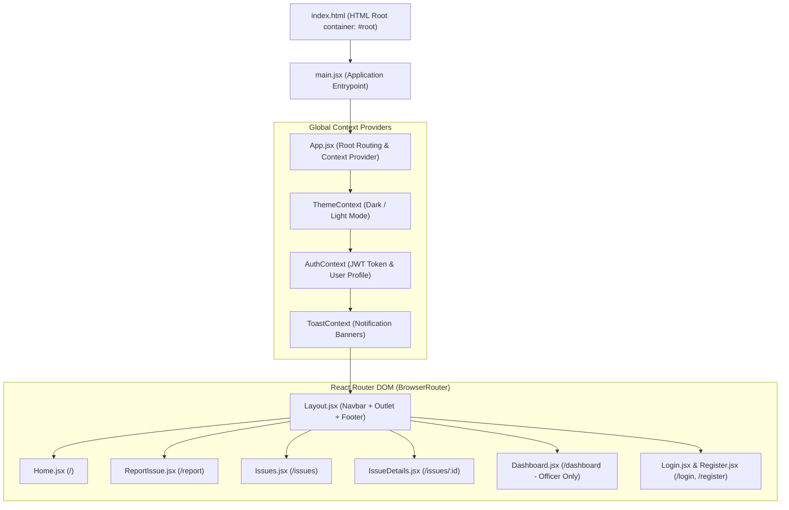

# CivicConnect — Frontend Architecture & Blueprint (`view.md`)

This document provides a comprehensive, simple, and detailed blueprint of the **CivicConnect** frontend application. It explains how the application is built, which tools are used, how the program flows from start to finish, and how each screen and component is visually rendered.

---

## 1. High-Level Architecture & Tech Stack

CivicConnect's frontend is a high-performance **Single Page Application (SPA)** built with React 19 and Vite 7, styled using Tailwind CSS v4, and enriched with interactive mapping, 3D visual effects, and AI feedback.

### Key Tools & Libraries Used

| Tool / Library | Role / Purpose | Why It Is Used |
| :--- | :--- | :--- |
| **React 19** | Component-based UI engine | Declarative state management, fast virtual DOM, and modern React hooks. |
| **Vite 7** | Build tool & Dev server | Instant Hot Module Replacement (HMR) during development; optimized production bundling. |
| **Tailwind CSS v4** | Styling & layout | Modern utility-first CSS using `@tailwindcss/vite` for fast, zero-runtime styling and dark mode. |
| **React Router v7** | Client-side routing | Seamless navigation between pages (`/`, `/report`, `/issues`, `/dashboard`) without page reloads. |
| **Leaflet & React-Leaflet** | Interactive mapping | Open-source geographic maps (OpenStreetMap & Satellite tiles) with custom marker pins and GPS tracking. |
| **Three.js** | 3D Graphics & Canvas | Renders the immersive 3D particle and mesh civic backdrop on the intro animation. |
| **GSAP (GreenSock)** | Motion & Transitions | Delivers smooth timeline-based animations for cards, transitions, and sliders. |
| **Lucide React** | Iconography | Lightweight, consistent SVG icon set for navigation, alerts, pins, and actions. |
| **Axios** | HTTP API Client | Communicates with the Express backend; includes interceptors to automatically attach JWT Bearer tokens. |
| **Web Speech API** | Voice transcription | Native browser voice-to-text allowing citizens to speak their issue description in real time. |

---

## 2. Program Execution Flow

The frontend execution flows strictly from initialization to visual rendering:



### Detailed Lifecycle:
1. **Entry (`index.html` & `main.jsx`)**:
   - `index.html` loads fonts, stylesheets, and mounts `<div id="root"></div>`.
   - `main.jsx` initializes React 19's `createRoot()` and renders `<App />`.
2. **Context Layer (`App.jsx`)**:
   - **`ThemeContext`**: Checks `localStorage` or OS preferences to set `'dark'` or `'light'` mode on the `<html>` document.
   - **`AuthContext`**: Reads `civic_token` from `localStorage`, validates user credentials, and maintains user state (`citizen`, `officer`, `admin`).
   - **`ToastContext`**: Provides a global `toast.success()`, `toast.error()`, and `toast.info()` dispatcher for top-right feedback pills.
3. **Shell Layout (`Layout.jsx`)**:
   - **Navbar**: Displays brand emblem, navigation links, quick "Report Issue" action button, theme toggle, and authenticated user menu.
   - **Outlet**: Dynamically renders whichever route is currently active.
   - **Footer**: Brand links, civic links, and municipal disclaimers.

---

## 3. Screen-by-Screen Visual Blueprint

### Screen 1: Home Page (`Home.jsx`)
The landing experience combines civic accountability with engaging visuals:

```text
┌────────────────────────────────────────────────────────────────────────┐
│ NAVBAR: Logo [CivicConnect]  Feed  Report  Track  [Theme] [Profile]    │
├────────────────────────────────────────────────────────────────────────┤
│ 1. HERO SECTION                                                        │
│    Left: Kicker "CLEANER CITIES", Headline "Report. Track. Real Change"│
│          Buttons: [Report an Issue →]  [View Live Map]                 │
│          Social proof citizen avatars (+Live Count)                    │
│    Right: HeroMapWidget (Interactive GPS Leaflet map with priority     │
│           pins, satellite toggle, category filter, and selected card)  │
├────────────────────────────────────────────────────────────────────────┤
│ 2. LIVE CIVIC PULSE                                                    │
│    Metric Cards: [Total Reported] [In Progress] [Resolved] [Rate %]    │
├────────────────────────────────────────────────────────────────────────┤
│ 3. HOW IT WORKS (Workflow Section)                                     │
│    Step 1: Snap Photo → Step 2: AI Audit → Step 3: Officer Assigned → │
│    Step 4: Active Work → Step 5: Citizen Sign-off                      │
├────────────────────────────────────────────────────────────────────────┤
│ 4. RECENT ISSUES GRID                                                  │
│    [Issue Card 1]  [Issue Card 2]  [Issue Card 3]  [+ Report New Card] │
├────────────────────────────────────────────────────────────────────────┤
│ 5. VERIFIED ISSUES. REAL ACTION.                                       │
│    Interactive Before-After Slider (Initial Pothole vs Completed Fix)  │
│    with Gemini Vision Match Score & Inspection Summary                 │
├────────────────────────────────────────────────────────────────────────┤
│ 6. CITIZENS CITY BANNER & PANORAMA CALL-TO-ACTION                      │
├────────────────────────────────────────────────────────────────────────┤
│ FOOTER: Municipal links, Smart City Ward info, Copyright               │
└────────────────────────────────────────────────────────────────────────┘
```

#### Key Subcomponents on the Home Page:
- **`HeroMapWidget.jsx`**: Auto-detects device GPS location with high-accuracy fallback. Renders color-coded Leaflet markers based on issue priority (Rose = Urgent/High, Amber = Medium, Slate = Low).
- **`RecentIssuesSection.jsx`**: Displays real recently reported issues from the database with category badges, time-ago calculations, and fallback sample cards when the database is fresh.
- **`BeforeAfterSlider.jsx`**: An interactive split-screen image slider comparing original citizen photos with officer resolution photos.
- **`CivicIntroAnimation.jsx`**: Three.js WebGL canvas displaying a subtle 3D particle background for brand visual identity.

---

### Screen 2: Report an Issue (`ReportIssue.jsx`)
The primary citizen intake flow:
1. **Photo Upload**: Drag-and-drop or file picker with 5MB client-side validation.
2. **Instant Vision AI Trigger**: Uploading a photo immediately calls `POST /api/issues/analyze-image`. Google Gemini classifies the scene, detects hazards, suggests a category, and scores severity in real time.
3. **Voice Input (`speechService.js`)**: Citizens can click the microphone icon and speak; the browser's Web Speech API converts their speech to written text in the description box.
4. **Interactive Location Picker (`MapPicker.jsx`)**: Lets the user drag a marker across the map or click "Use Current Location" to pin exact GPS coordinates with reverse geocoding.
5. **Duplicate Warning**: Detects if another issue has already been reported within 50 meters.

---

### Screen 3: Issue Feed & Details (`Issues.jsx` & `IssueDetails.jsx`)
- **Feed**: Search by keyword, filter by category (`road`, `garbage`, `streetlight`, `water`, `drainage`, `traffic`), filter by status (`NEW`, `IN_PROGRESS`, `RESOLVED`, `CLOSED`), and toggle between Grid and Map view.
- **Details**: Full issue audit dossier (`OfficialAuditReport.jsx`), status progress bar, uploaded before/after evidence photos, citizen confirmation and dispute buttons, and comments timeline.

---

### Screen 4: Officer Command Dashboard (`Dashboard.jsx`)
Role-restricted interface for municipal field officers:
- Status KPI counters (New, Assigned, In Review, Completed).
- Quick assignment dropdown.
- Phase Transition Engine: Enforces state machine progression (`NEW` $\rightarrow$ `IN_PROGRESS` $\rightarrow$ `RESOLUTION_REVIEW` $\rightarrow$ `RESOLVED`).
- Proof-of-Fix Upload: Officer uploads the repaired site photo, which triggers Gemini Vision before/after comparison to generate an automated resolution score.

---

## 4. Design Philosophy & Visual Language

- **Monochrome & Urgency Accents**: The base application uses pure whites, neutral zincs, and deep blacks for clarity. Colored accents are strictly reserved for civic urgency:
  - **Urgent / High**: Red / Rose (`#EF4444`)
  - **Medium**: Amber (`#F59E0B`)
  - **Low / General**: Slate / Neutral (`#64748B`)
  - **Verified / Resolved**: Emerald / Black
- **Bento Grid Architecture**: Cards utilize subtle `1px` border lines (`border-neutral-200 dark:border-neutral-800`), rounded corners (`rounded-2xl`), and gentle hover lifts (`hover:shadow-md`).
- **Zero Layout Shifts**: Images utilize fixed aspect ratio containers (`aspect-16/10`) with fallback SVG icons to prevent visual jumping during network loading.
