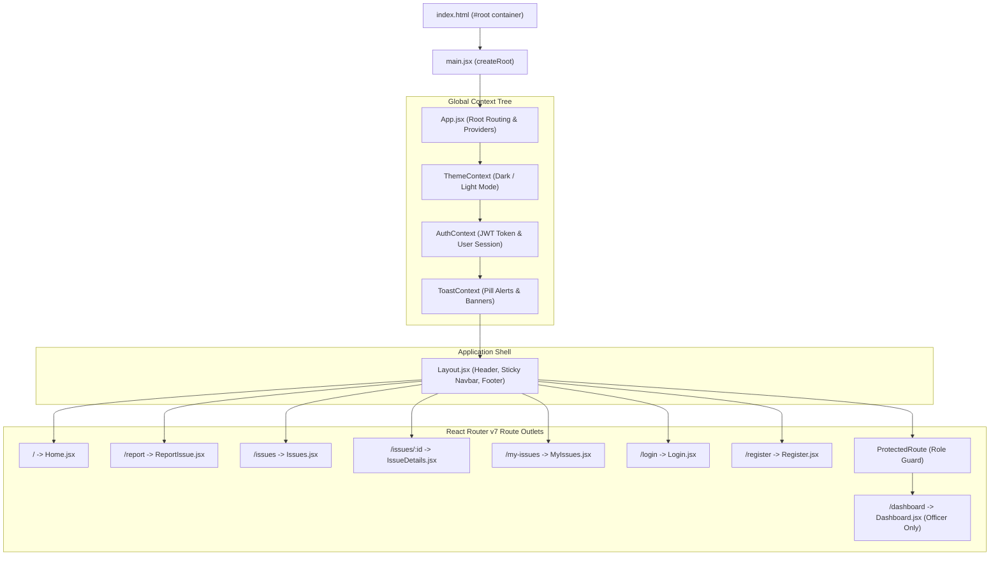
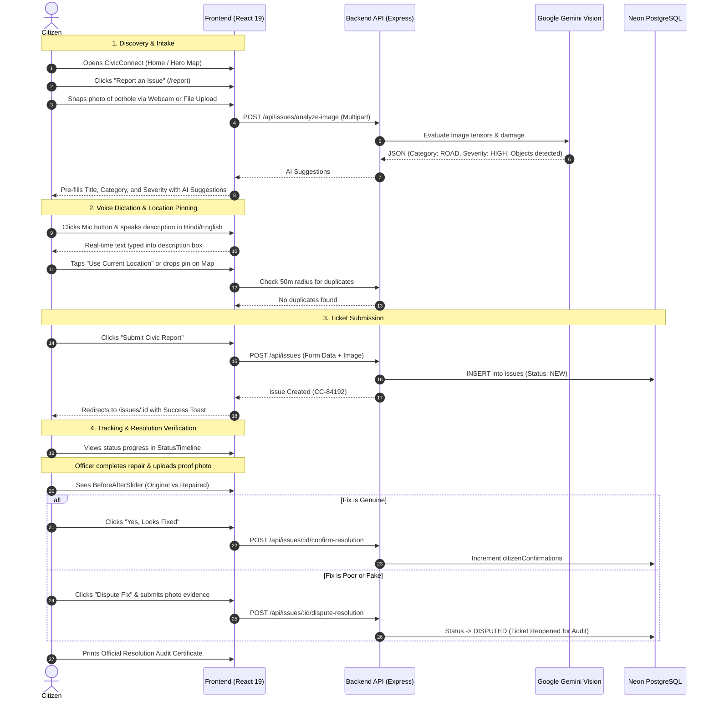
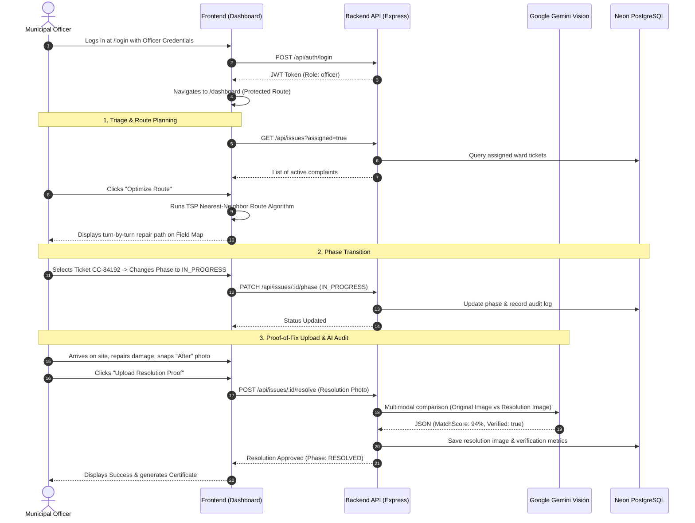

# CivicConnect — Complete Frontend Architecture & Interaction Blueprint (`view.md`)

This document is the definitive master blueprint of the **CivicConnect** frontend application. It details the complete architecture, component-by-component feature breakdowns, program execution flows, visual styling systems, and exhaustive step-by-step user interaction walkthroughs for both **Citizens** and **Municipal Officers**.

---

## Table of Contents
1. [High-Level Architecture & Tech Stack](#1-high-level-architecture--tech-stack)
2. [Frontend Directory & File Structure](#2-frontend-directory--file-structure)
3. [Program Execution Flow & State Lifecycles](#3-program-execution-flow--state-lifecycles)
4. [Exhaustive Component Feature Catalog (18 Components)](#4-exhaustive-component-feature-catalog)
5. [Page-by-Page Feature & Visual Breakdown (8 Pages)](#5-page-by-page-feature--visual-breakdown)
6. [How the System is Viewed & Interacted With (User Journeys)](#6-how-the-system-is-viewed--interacted-with)
   - [Citizen Interaction Journey](#the-citizen-journey)
   - [Municipal Officer Interaction Journey](#the-municipal-officer-journey)
   - [Municipal Administrator / Auditor Journey](#the-municipal-administrator--auditor-journey)
7. [Visual Design System, Accessibility & Theming](#7-visual-design-system-accessibility--theming)

---

## 1. High-Level Architecture & Tech Stack

CivicConnect's frontend is a high-performance **Single Page Application (SPA)** built with React 19 and Vite 7. It combines modern responsive web engineering with geographic mapping, real-time AI feedback via Google Gemini Vision, Web Speech voice dictation, and hardware-accelerated 3D WebGL graphics.

### Core Technologies

| Tool / Library | Role / Purpose | Why It Is Used |
| :--- | :--- | :--- |
| **React 19** | Component-Based UI Engine | Modern declarative UI, instant virtual DOM diffing, and optimized custom hooks. |
| **Vite 7** | Build Engine & Dev Server | Lightning-fast Hot Module Replacement (HMR) and optimized Rollup tree-shaking for production. |
| **Tailwind CSS v4** | Utility-First Styling | Zero-runtime CSS with `@tailwindcss/vite`, responsive breakpoints, and native dark-mode class toggling. |
| **React Router v7** | Client-Side Routing | Smooth SPA transitions across routes (`/`, `/report`, `/issues`, `/issues/:id`, `/dashboard`, `/my-issues`) without page reloads. |
| **Leaflet & React-Leaflet** | Interactive Mapping | Dual-layer geospatial maps (Google High-Res Satellite + OpenStreetMap) with custom SVG markers, GPS tracking, and route polylines. |
| **Three.js** | 3D Graphics & Canvas | Procedural WebGL rendering for the cinematic intro city grid, glowing beacons, and atmospheric perspective. |
| **GSAP (GreenSock)** | Motion & Animation | High-performance timeline animations for the 3D cinematic camera transitions and interactive cards. |
| **Lucide React** | Iconography | Lightweight, consistent SVG iconography for civic categories, statuses, navigation, and alerts. |
| **Axios** | HTTP API Client | Centralized REST client with automatic JWT Bearer token attachment and response error interception. |
| **Web Speech API** | Voice Dictation | Native in-browser speech recognition (English + Hindi) and speech synthesis for accessible issue reporting. |

---

## 2. Frontend Directory & File Structure

```text
client/
├── index.html                   # HTML entrypoint with viewport, fonts, and #root
├── vite.config.js               # Vite 7 build configuration with Tailwind CSS v4 plugin
├── vercel.json                  # Production SPA rewrite rule for clean routing
├── package.json                 # Dependencies and scripts (dev, build, preview)
├── view/                        # Visual blueprints, screenshots, and architecture docs
│   ├── README.md                # Quick summary of the view directory
│   └── view.md                  # This complete architecture and component manual
└── src/
    ├── main.jsx                 # React root creation and mounting
    ├── App.jsx                  # Main routing tree and global Context providers
    ├── index.css                # Base Tailwind imports, custom scrollbars, animations
    ├── api.js                   # Axios HTTP client with JWT interceptor
    │
    ├── assets/                  # High-resolution civic visual assets
    │   ├── varanasi_ghats_sketch.jpg        # Heritage architectural sketch for civic pride banner
    │   └── city_ghats_night_panorama.jpg    # Night skyline banner for command CTA
    │
    ├── context/                 # Global state management providers
    │   ├── AuthContext.jsx      # User profile, JWT session persistence, login, register, logout
    │   ├── ThemeContext.jsx     # Dark mode / Light mode switching and localStorage memory
    │   └── ToastContext.jsx     # Global notification toast dispatcher (success, error, info)
    │
    ├── services/                # Device & browser hardware services
    │   └── speechService.js     # Web Speech API wrapper for bilingual voice recognition
    │
    ├── utils/                   # Client-side utility helpers
    │   ├── geolocation.js       # HTML5 GPS locator, Haversine formula, reverse geocoding
    │   └── image.js             # Local/cloud image URL resolver with fallback handling
    │
    ├── components/              # Modular, reusable UI components
    │   ├── AiAnalysisDemo.jsx          # Interactive AI verification demo card with checklist
    │   ├── BeforeAfterSlider.jsx       # Split-view & drag-slider proof-of-fix comparator
    │   ├── CitizensCityBanner.jsx      # Heritage sketch banner with live citywide metrics
    │   ├── CivicCommandCTA.jsx         # Night skyline call-to-action section
    │   ├── CivicIntroAnimation.jsx     # 3D Three.js WebGL procedural city cinematic
    │   ├── CivicLogo.jsx               # Vector brand mark (Hex shield, node grid, beacon)
    │   ├── CivicPulseSection.jsx       # 4 live civic telemetry cards with animated pulse
    │   ├── CivicWorkflowSection.jsx    # 5-step visual civic resolution process cards
    │   ├── CommunityMap.jsx            # Full Leaflet map view for issues feed with satellite toggle
    │   ├── HeroMapWidget.jsx           # Interactive GPS Leaflet widget for the home hero
    │   ├── IssueCard.jsx               # Bento-style civic issue card with optimistic upvotes
    │   ├── IssueLifecycleTimeline.jsx  # Interactive issue lifecycle history explorer
    │   ├── Layout.jsx                  # Sticky navbar, search bar, theme toggle, and footer
    │   ├── MapPicker.jsx               # Click-to-pin coordinate picker with satellite tiles
    │   ├── OfficialAuditReport.jsx     # Printable government audit certificate & PDF preview
    │   ├── ProtectedRoute.jsx          # Role-based route guard for officers and admins
    │   ├── RecentIssuesSection.jsx     # Live 3-card recent issues grid with loading skeletons
    │   └── StatusTimeline.jsx          # Lifecycle phase progression bar with dispute banners
    │
    └── pages/                   # Top-level screen views
        ├── Home.jsx             # Flagship landing page with hero, pulse, map, and proof
        ├── ReportIssue.jsx      # Citizen intake form (Camera, Voice, AI scan, Map pin)
        ├── Issues.jsx           # Public civic feed with Grid/Map view, search, and category pills
        ├── IssueDetails.jsx     # Full issue audit dossier, comments, before/after, and disputes
        ├── Dashboard.jsx        # Municipal officer command center with TSP route optimizer
        ├── MyIssues.jsx         # Citizen personal report tracking portal
        ├── Login.jsx            # Authentication form with quick-fill demo credentials
        └── Register.jsx         # New citizen account registration form
```

---

## 3. Program Execution Flow & State Lifecycles

### Complete Application Initialization Flow



### Context & State Lifecycles

1. **`ThemeContext.jsx`**:
   - Reads `localStorage.getItem("civic_theme")` or defaults to OS preference (`prefers-color-scheme: dark`).
   - Dynamically adds or removes the `dark` class on `document.documentElement` (`<html>`).
   - Exposes `theme`, `toggleTheme()`, and boolean `isDark` to all components.

2. **`AuthContext.jsx`**:
   - On mount, inspects `localStorage.getItem("civic_token")`.
   - If present, sets Axios default header `Authorization: Bearer <token>` and fetches current user details via `/api/auth/me`.
   - Exposes `user` (`{ id, name, email, role, ward }`), `token`, `login()`, `register()`, and `logout()`.

3. **`ToastContext.jsx`**:
   - Manages an array of ephemeral alert toasts rendered in a fixed top-right overlay.
   - Provides methods `toast.success(msg)`, `toast.error(msg)`, `toast.info(msg)`, and `toast.warn(msg)` with 4-second auto-dismissal and enter/exit slide animations.

4. **API Interceptor Architecture (`api.js`)**:
   - Request Interceptor: Automatically attaches the current Bearer token to all outgoing API calls.
   - Response Interceptor: Listens for `401 Unauthorized` responses and cleanly logs out expired sessions without crashing the UI.

---

## 4. Exhaustive Component Feature Catalog

Below is a detailed breakdown of all 18 UI components, detailing their layout role, user interaction capabilities, state management, and props.

---

### 1. `CivicLogo.jsx`
* **Path**: `client/src/components/CivicLogo.jsx`
* **Role**: The official vector brand emblem of CivicConnect.
* **Visual Elements**:
  - **Hexagonal Civic Shield**: Represents institutional protection, durability, and urban resilience.
  - **Internal Network Grid**: Clean 45° and 90° lines depicting connected citizen-officer community nodes.
  - **Geotag Beacon**: Central pin marker with a focal point representing localized civic interventions.
* **Props**:
  - `size` (default `28`): Width and height in pixels.
  - `className`: Tailwind classes for hover scaling, fills, and transition effects.
* **Theme Support**: Adapts automatically with `stroke-black dark:stroke-white fill-white dark:fill-black`.

---

### 2. `CivicIntroAnimation.jsx`
* **Path**: `client/src/components/CivicIntroAnimation.jsx`
* **Role**: Cinematic 3D WebGL introduction rendered on initial site visit.
* **Key Features**:
  - **Three.js Scene**: Procedural 50x50 perspective grid, 3D cuboid city skyline with illuminated wireframe edges, glowing ambient point lights, and an atmospheric black fog effect.
  - **GSAP Orchestrated Stages**:
    - *Stage 0*: Pitch-black void camera approach.
    - *Stage 1*: Issue detection pulse and scanner overlay.
    - *Stage 2*: Sensor network connection between city towers.
    - *Stage 3*: Brand reveal with holographic typography.
    - *Stage 4*: Smooth exit dissolve into the landing page.
  - **Smart Memory**: Saves a `hasSeenIntro` flag in `sessionStorage` so returning users during the same session are not interrupted.
  - **Interactive Controls**: Includes an interactive "Skip Intro" button with animated hover styling.

---

### 3. `HeroMapWidget.jsx`
* **Path**: `client/src/components/HeroMapWidget.jsx`
* **Role**: Flagship interactive Leaflet map widget mounted on the right half of the Home page hero section.
* **Key Features**:
  - **Hardware GPS Geolocation**: Calls browser GPS with fallback to IP-based coordinates (`fetchLocalCoordinates()`). Smoothly centers the map using animated `flyTo()`.
  - **Reverse Geocoding**: Converts raw coordinates into readable place names (e.g. "Near Varanasi, Uttar Pradesh") displayed in the header banner.
  - **Dual Tile Layers**: One-click switcher between **Google High-Res Satellite Imagery** and **OpenStreetMap Street Map**.
  - **Dynamic Urgency Pins**: Map markers color-coded by severity (Urgent = Red `#EF4444`, Medium = Amber `#F59E0B`, Low = Slate `#64748B`) with animated ping ripples on selected pins.
  - **Floating Preview Card**: Clicking any pin displays a popover card showing issue photo, title, category, distance from user in kilometers (`calculateDistanceKm`), and an "Inspect Report →" link.
  - **Zoom & Re-Center Controls**: Custom styled floating zoom in/out buttons and a "Crosshair" button to instantly re-center on the citizen's current device position.

---

### 4. `CivicPulseSection.jsx`
* **Path**: `client/src/components/CivicPulseSection.jsx`
* **Role**: Real-time civic telemetry dashboard displaying live municipal health metrics.
* **Key Features**:
  - **Live Indicator**: Pulsing black/white radar dot with "LIVE CIVIC PULSE" tag and relative time-sync indicator.
  - **4 Stat Bento Cards**:
    1. *Total Reports*: Total historical tickets submitted across all wards.
    2. *Active Issues*: Currently unresolved tickets in queue (`NEW` + `IN_PROGRESS`).
    3. *Verified Reports*: Percentage of reports verified via automated GPS and Gemini AI tensors.
    4. *Avg. Response Time*: Municipal service level response time (e.g., `< 24h`).
  - **Data Fetching**: Queries `/api/issues/stats` automatically on mount with fallback defaults during cold-starts.

---

### 5. `CivicWorkflowSection.jsx`
* **Path**: `client/src/components/CivicWorkflowSection.jsx`
* **Role**: Step-by-step visual explainer illustrating how CivicConnect transforms complaints into verified physical fixes.
* **Key Features**:
  - **5 Sequential Process Cards**:
    - `01 Report`: Submit an issue with camera photo and GPS location.
    - `02 Verification`: AI audits the image authenticity, validates GPS coordinates, and prevents duplicates.
    - `03 Assign`: Municipal ward supervisor triages and assigns the ticket to field personnel.
    - `04 Action`: Field crew arrives on-site; real-time repair work is tracked.
    - `05 Resolved`: Proof-of-fix photo uploaded; citizen reviews and confirms the fix.
  - **Visual Connectors**: Integrated directional arrows between cards on desktop viewports.

---

### 6. `RecentIssuesSection.jsx`
* **Path**: `client/src/components/RecentIssuesSection.jsx`
* **Role**: Live dynamic feed displaying the 3 most recently reported community issues on the Home page.
* **Key Features**:
  - **Real Database Integration**: Fetches live issues from `GET /api/issues` on load.
  - **Loading Skeletons**: Displays animated shimmer placeholder cards while data is in flight to eliminate layout shifts.
  - **Zero-State Fallback**: If the database is completely empty, renders 3 curated realistic civic examples so the UI never displays broken empty space.
  - **Time-Ago Calculation**: Converts timestamps into human-friendly relative strings ("Just now", "3 hours ago", "2 days ago").
  - **Action Card**: A dedicated 4th card with a dashed border prompting users to "+ Report an Issue" leading directly to `/report`.

---

### 7. `AiAnalysisDemo.jsx`
* **Path**: `client/src/components/AiAnalysisDemo.jsx`
* **Role**: Interactive verification laboratory demonstrating how Google Gemini Vision audits civic complaints.
* **Key Features**:
  - **Interactive Ticket Selector**: Allows users to switch between real submitted issues with image evidence.
  - **4-Point Verification Checklist**:
    1. *Image Analysis*: Evidence photo analyzed, visual tensors validated, damage detected.
    2. *Location Match*: GPS coordinates validated against municipal boundary shapefiles.
    3. *Duplicate Check*: Confirms no matching ticket exists within a 500-meter radius.
    4. *Timestamp Valid*: Confirms photo metadata is fresh and not an old internet scrape.
  - **Simulated HUD Overlay**: High-tech camera inspection window displaying bounding box outlines, AI confidence rating (e.g. `96.4%`), detected damage category, and a button to view the full audit dossier.
  - **Fullscreen Modal**: Click to expand image into a high-res inspection overlay.

---

### 8. `BeforeAfterSlider.jsx`
* **Path**: `client/src/components/BeforeAfterSlider.jsx`
* **Role**: Split-screen image comparison component used to visually audit completed repairs.
* **Key Features**:
  - **Dual Modes**:
    - *Slider Mode*: Interactive drag handle enabling users to slide left and right across 0%–100% of the image, revealing the original damage underneath the finished repair. Supports both desktop mouse events and mobile touch gestures (`onTouchMove`).
    - *Side-by-Side Mode*: Split dual-column view displaying both photos simultaneously for static comparisons.
  - **Pill Badges**: Prominent visual labels distinguishing "Original Report (Before)" from "Proof of Fix (After)".
  - **Fixed Aspect Ratio**: Prevents layout reflow using configurable aspect containers (default `16/9` or `16/10`).

---

### 9. `CitizensCityBanner.jsx`
* **Path**: `client/src/components/CitizensCityBanner.jsx`
* **Role**: Civic pride and cultural heritage showcase highlighting the connection between citizens and historic urban preservation.
* **Key Features**:
  - **Architectural Artwork**: Displays a high-resolution monochrome sketch of heritage river ghats and historic city architecture.
  - **Live Impact Metrics**: Displays 3 real-time counters fetched from `/api/issues/stats` (Citizen Reports, Citywide Coverage, Issues Resolved).
  - **Call to Action**: Quick button linking directly to the full community issues feed (`/issues`).

---

### 10. `CivicCommandCTA.jsx`
* **Path**: `client/src/components/CivicCommandCTA.jsx`
* **Role**: Immersive panoramic call-to-action placed at the bottom of the Home page.
* **Key Features**:
  - **Night Panorama**: Features an evocative night skyline backdrop of city ghats illuminated under dusk lighting.
  - **Role-Aware CTAs**: Inspects the user's role from `AuthContext`:
    - Citizens see: "Report an Issue →" and "Explore Public Map".
    - Municipal Officers see: "Open Command Dashboard →" and "View Field Queue".

---

### 11. `IssueCard.jsx`
* **Path**: `client/src/components/IssueCard.jsx`
* **Role**: The standard Bento-grid card used across the Home page, Issues feed, and Citizen portal.
* **Key Features**:
  - **Aspect-Ratio Thumbnail**: Responsive image container with fallback category illustrations if no photo was uploaded.
  - **Category & Severity Badges**: Clean emoji + label pills (e.g., 🛣️ Road Damage, 🗑️ Waste) and color-coded priority indicators (Urgent, High, Medium, Low).
  - **Optimistic Upvote Engine**: Clicking the upvote button immediately increments the count in the UI. If the backend call fails, it automatically rolls back and notifies the user via Toast. Prompts unauthenticated users to log in.
  - **AI Verification Badge**: Displays an "AI Verified" badge with a green shield if Gemini confirmed the repair.
  - **Dispute Alert**: If citizen disputes exceed confirmations, card displays a bold red "DISPUTED" badge.
  - **Location & Comments**: Displays ward address snippet and total comment count pill.

---

### 12. `StatusTimeline.jsx`
* **Path**: `client/src/components/StatusTimeline.jsx`
* **Role**: Visual lifecycle progress tracker displayed on the Issue Details page.
* **Key Features**:
  - **5-Stage Step Bar**: Displays progress across `NEW` $\rightarrow$ `IN_PROGRESS` $\rightarrow$ `RESOLUTION_REVIEW` $\rightarrow$ `RESOLVED` $\rightarrow$ `CLOSED`.
  - **Rejected Handling**: Renders a dedicated red banner displaying the officer's rejection justification remarks.
  - **Dispute Detection & Auto-Reopen**: Detects if an issue has active citizen disputes. Automatically indicates the ticket is "REOPENED" and marked for supervisory audit.
  - **Chronological Audit Trail**: Below the bar, lists every historical transition with exact date/time, acting officer's name, and transition remarks.

---

### 13. `IssueLifecycleTimeline.jsx`
* **Path**: `client/src/components/IssueLifecycleTimeline.jsx`
* **Role**: Standalone interactive lifecycle demonstrator used on the Home and About sections.
* **Key Features**:
  - Lets visitors select different issues from a dropdown to inspect how different tickets moved from intake through field repair to final sign-off.
  - Renders actor avatars, department labels, and resolution notes.

---

### 14. `CommunityMap.jsx`
* **Path**: `client/src/components/CommunityMap.jsx`
* **Role**: Full-page interactive Leaflet map view for the `/issues` route.
* **Key Features**:
  - **Satellite & Street Toggle**: Toggle between high-resolution Google Satellite tiles and OpenStreetMap tiles.
  - **Automated Centering**: Auto-detects device coordinates and flies to user's neighborhood.
  - **Pulsing Urgency Markers**: Color-coded pins with CSS pulse animations.
  - **Rich Marker Popups**: Clicking a pin opens a popup featuring the thumbnail image, title, category, priority, and direct link to the details page.
  - **Bounds Fitting**: Automatically zooms and pans to fit all filtered markers within view.

---

### 15. `MapPicker.jsx`
* **Path**: `client/src/components/MapPicker.jsx`
* **Role**: Geographic coordinate selection tool used during issue reporting (`ReportIssue.jsx`) and issue inspection (`IssueDetails.jsx`).
* **Key Features**:
  - **Click-to-Pin**: Clicking anywhere on the map drops a pin and reports exact 6-decimal latitude and longitude to the parent form.
  - **Read-Only Mode**: In `IssueDetails.jsx`, locks the pin to display the exact verified coordinate of the reported civic issue.
  - **Satellite Imagery**: Default Google Satellite basemap for accurate landmark identification.

---

### 16. `OfficialAuditReport.jsx`
* **Path**: `client/src/components/OfficialAuditReport.jsx`
* **Role**: Printable, tamper-proof municipal resolution certificate and anti-corruption audit report.
* **Key Features**:
  - **Print / PDF Generation**: Triggered via `window.print()` with custom `@media print` stylesheets that strip browser chrome, navigation bars, and buttons to produce a pristine A4 document.
  - **Document Header**: Displays official Department of Urban Development seal, unique Document Reference code (`CC-AUDIT-<issueCode>`), date of issuance, and authentication watermark.
  - **Evidence Dossier**: Displays the citizen's original report photo side-by-side with the field officer's proof-of-fix photo.
  - **AI Verification Seal**: Displays the Gemini Vision similarity match score (e.g. 94%), confidence score, and verification timestamp.
  - **Signatory Block**: Formal sign-off lines for the Municipal Field Engineer and Zonal Ward Supervisor.

---

### 17. `ProtectedRoute.jsx`
* **Path**: `client/src/components/ProtectedRoute.jsx`
* **Role**: High-security route wrapper guarding officer and admin endpoints.
* **Key Features**:
  - **Loading Enclave Animation**: Displays an animated spinning radar with "VERIFYING CIVIC CREDENTIALS" while authentication status is being checked.
  - **Unauthenticated Redirect**: Seamlessly redirects unauthenticated users to `/login`, preserving their target destination in router state (`state: { from: location.pathname }`).
  - **Role Enforcement**: If a user lacks the required role (e.g., a citizen trying to access `/dashboard`), safely redirects them to `/` without leaking interface elements.

---

### 18. `Layout.jsx`
* **Path**: `client/src/components/Layout.jsx`
* **Role**: The global application shell enclosing every page.
* **Key Features**:
  - **Sticky Backdrop-Blur Header**: Floats above page content with smooth shadow transitions on scroll.
  - **Global Quick Search**: Integrated search bar allowing users to search keywords across all issues from any page.
  - **Theme Toggle Switch**: Instant toggle between Dark Mode and Light Mode with rotating Sun/Moon icons.
  - **User Profile Dropdown**: Displays authenticated user avatar, full name, role badge (`Citizen`, `Officer`, `Admin`), quick links to "My Issues" or "Officer Dashboard", and "Logout".
  - **CTA Button**: High-visibility "Report Issue" action button.
  - **Responsive Mobile Drawer**: Collapsible slide-out navigation menu for mobile screens.
  - **Comprehensive Footer**: Municipal department links, emergency helpline numbers, copyright notices, and platform links.

---

## 5. Page-by-Page Feature & Visual Breakdown

### 1. Home Page (`Home.jsx` - Route `/`)
* **Purpose**: The main public landing page showcasing city status, recent complaints, interactive maps, and proof of work.
* **Layout Structure**:
  1. *Hero Section*: High-impact headline ("Cleaner Cities. Less Friction. Real Change."), citizen avatars, action buttons, and the interactive `HeroMapWidget`.
  2. *Live Civic Pulse*: 4 real-time KPI telemetry cards (`CivicPulseSection`).
  3. *How It Works*: 5-step visual workflow explanation (`CivicWorkflowSection`).
  4. *Recent Issues Grid*: 3 live issues from the database with category badges + 1 "+ Report an Issue" card (`RecentIssuesSection`).
  5. *AI Verification Showcase*: Interactive Gemini Vision verification lab (`AiAnalysisDemo`).
  6. *Heritage Pride Banner*: Sketch artwork with citywide coverage metrics (`CitizensCityBanner`).
  7. *Command CTA*: Night skyline call-to-action (`CivicCommandCTA`).

---

### 2. Report Issue Page (`ReportIssue.jsx` - Route `/report`)
* **Purpose**: The primary intake portal for citizens to submit verified civic problems.
* **Key Sub-Features**:
  - **Camera Hardware Integration**: Allows capturing live photos directly through device webcam/phone camera (`getUserMedia`), complete with video stream view, capture trigger, and image preview.
  - **File Upload & Drag-and-Drop**: Supports JPEG, PNG, and WebP files up to 5MB with client-side file size and MIME-type validation.
  - **Instant Gemini Vision Pre-Analysis**: Uploading or snapping a photo immediately calls `POST /api/issues/analyze-image`. In ~2 seconds, Gemini inspects the image and returns suggested Title, Description, Category, Severity, and Department.
  - **One-Click AI Acceptance**: The citizen can click "Accept AI Suggestions" to automatically populate form fields, or edit them manually.
  - **Bilingual Voice Dictation (`speechService.js`)**: Citizens can click the microphone button and speak in either **English** or **Hindi**. The Web Speech API transcribes speech directly into the description box.
  - **Real-Time Geo-Deduplication**: As soon as coordinates are selected, the system queries the backend. If an existing open issue is found within 50 meters, a warning banner appears with a link to upvote the existing ticket instead of creating a duplicate.
  - **Interactive Map Pinning (`MapPicker.jsx`)**: Lets the user click to drop a pin or tap "Use My Current Location" via HTML5 Geolocation, automatically reverse-geocoding the address.

---

### 3. Issues Feed Page (`Issues.jsx` - Route `/issues`)
* **Purpose**: Public transparency feed allowing anyone to search, filter, and view reported civic issues across the municipality.
* **Key Sub-Features**:
  - **Dual View Modes**: Toggle between **Grid View** (cards) and **Map View** (`CommunityMap.jsx`).
  - **Category Filter Pills**: Quick-filter bar with icons (All, Roads 🛣️, Garbage 🗑️, Lights 💡, Water 🚰, Drainage 🌊, Electricity ⚡, Traffic 🚦, Safety 🚨, Parks 🌳).
  - **Status Filter**: Dropdown filtering by lifecycle phase (`All`, `Reported`, `In Progress`, `Resolution Review`, `Resolved`, `Closed`).
  - **Real-Time Keyword Search**: Filters issues by title, description, or address.
  - **Reset Filters**: One-click button to clear all active filters.

---

### 4. Issue Details Page (`IssueDetails.jsx` - Route `/issues/:id`)
* **Purpose**: Comprehensive audit dossier for an individual civic complaint.
* **Key Sub-Features**:
  - **Evidence Viewer**: Displays high-resolution photos. When resolved, mounts the interactive `BeforeAfterSlider` comparing the original issue against the completed repair.
  - **AI Inspection Report**: Visual breakdown of Gemini's analysis: detected objects, damage extent, safety hazards, risk level, and AI confidence ring.
  - **Lifecycle Timeline (`StatusTimeline.jsx`)**: Step-by-step progress from report to closure with dispute warnings.
  - **Community Verification & Sign-off Panel**:
    - "Yes, Looks Fixed" button (`/confirm-resolution`).
    - "Dispute Fix" button (`/dispute-resolution`) opening a dispute modal to submit photo evidence and notes explaining why the fix is inadequate.
    - Community consensus meter showing confirmation vs dispute ratio.
  - **Print Official Audit Certificate**: Opens the printable `OfficialAuditReport` modal.
  - **Comment Stream**: Chronological citizen and officer discussion thread with text input.
  - **Social Sharing**: One-click URL copy or native mobile Web Share integration.

---

### 5. Officer Dashboard (`Dashboard.jsx` - Route `/dashboard`)
* **Purpose**: Command center for municipal field officers and zonal supervisors.
* **Key Sub-Features**:
  - **7 KPI Status Counters**: Real-time counts for `New`, `In Progress`, `In Review`, `Resolved`, `Closed`, `Rejected`, and `Total`.
  - **Traveling Officer Route Optimizer**: An automated traveling salesperson (TSP) nearest-neighbor algorithm that calculates the optimal driving/inspection route between active complaints, rendering polylines on an interactive map.
  - **Dual Display Modes**: Toggle between **List View** (sortable table of tickets) and **Field Map View** (interactive Leaflet map with route lines).
  - **Phase Transition Engine**: Dropdown controller allowing officers to move tickets through the state machine:
    $$\text{NEW} \longrightarrow \text{IN\_PROGRESS} \longrightarrow \text{RESOLUTION\_REVIEW} \longrightarrow \text{RESOLVED}$$
  - **Proof-of-Fix Upload Modal**: Officer takes or uploads a photo of the completed repair on-site. The backend triggers Gemini Vision to compare the before and after photos, generating an automated match score and confidence rating.
  - **Dispute Resolution Management**: Flags tickets disputed by citizens with direct supervisory review tools.

---

### 6. Citizen Portal (`MyIssues.jsx` - Route `/my-issues`)
* **Purpose**: Personalized dashboard for citizens to track their submitted reports.
* **Key Sub-Features**:
  - Displays all issues reported by the logged-in user.
  - Real-time status badges showing current repair phase.
  - Empty state with quick button to "Report your first issue".

---

### 7. Login Page (`Login.jsx` - Route `/login`)
* **Purpose**: Secure user authentication.
* **Key Sub-Features**:
  - Email and password input with client validation.
  - **Demo Account Quick-Fill Buttons**: One-click buttons to instantly log in as `Citizen Demo` (`citizen@civicconnect.demo`) or `Officer Demo` (`officer@civicconnect.demo`).
  - Redirect preservation: Automatically sends the user back to the page they were attempting to view.

---

### 8. Register Page (`Register.jsx` - Route `/register`)
* **Purpose**: Citizen account creation.
* **Key Sub-Features**:
  - Full name, email, password, and phone number fields.
  - Password strength validation.
  - Direct account creation and immediate JWT login handshake.

---

## 6. How the System is Viewed & Interacted With

CivicConnect is built around two primary user journeys: the **Citizen Journey** and the **Municipal Officer Journey**.

---

### The Citizen Journey



#### Detailed Step-by-Step Citizen Walkthrough:
1. **Landing & Exploration**:
   - The citizen visits `http://localhost:5173`. They are greeted by the clean, modern interface and live city telemetry in the `CivicPulseSection`.
   - On the `HeroMapWidget`, they see issues pinned in their neighborhood with real-time urgency colors (Red for high priority, Amber for medium).
2. **Filing a Complaint**:
   - The citizen clicks **"Report an Issue"**.
   - They click **"Take Photo"** to activate their phone/laptop camera or drag in an image of a broken road.
   - Within 2 seconds, Gemini Vision pre-classifies the image: *"Deep pothole with asphalt degradation"*, sets Category to *Road Damage*, and Severity to *HIGH*. The citizen clicks **"Accept AI Suggestions"**.
   - Rather than typing a lengthy explanation, the citizen clicks the **Microphone** icon and speaks: *"There is a huge pothole here causing traffic jams."* The Web Speech API transcribes their voice instantly.
   - The citizen clicks **"Use My Location"**; the Leaflet map centers on their coordinates, reverse geocodes the street address, and confirms no duplicate issue exists nearby.
   - They click **"Submit Report"**. The issue is stored in PostgreSQL and assigned a unique tracking code (e.g. `CC-84192`).
3. **Public Community Support**:
   - Other citizens browse `/issues`, find the complaint, and click **"Upvote"**.
   - The optimistic UI increments immediately, raising the issue's priority score on municipal dashboards.
4. **Community Sign-Off (Anti-Corruption Verification)**:
   - When the field officer marks the repair finished, the citizen receives a status update.
   - They open `/issues/:id` and use the interactive **BeforeAfterSlider** to slide between the original pothole photo and the repaired road photo.
   - If satisfied, they click **"Yes, Looks Fixed"**. If the repair was poorly done or falsified, they click **"Dispute Fix"**, which reopens the ticket and notifies zonal supervisors.
   - They click **"Print Certificate"** to download the official municipal resolution certificate.

---

### The Municipal Officer Journey



#### Detailed Step-by-Step Officer Walkthrough:
1. **Accessing the Command Center**:
   - The officer logs in at `/login` (or uses the quick-fill "Officer Demo" button).
   - `ProtectedRoute.jsx` verifies their `officer` role and unlocks `/dashboard`.
2. **Reviewing the Queue & Optimizing Route**:
   - The officer views the 7 KPI counters: `New`, `In Progress`, `In Review`, `Resolved`, `Closed`, `Rejected`, `Total`.
   - Rather than manually guessing which site to visit first, the officer clicks **"Optimize Route"**.
   - The client-side nearest-neighbor TSP algorithm calculates the shortest driving circuit connecting all open complaints and draws the route polyline across the interactive Leaflet map.
3. **Field Execution & Proof-of-Fix Verification**:
   - The officer arrives at the site and sets the ticket phase to **`IN_PROGRESS`**.
   - Once the repair work is completed, the officer clicks **"Upload Proof-of-Fix"** and takes a photo of the completed site.
   - The backend runs both images through Gemini Vision's multimodal comparison engine.
   - Gemini confirms that the physical landmarks match and the damage has been repaired (e.g. `94% match score`).
   - The ticket transitions to **`RESOLVED`**, notifying the community for final verification.

---

### The Municipal Administrator / Auditor Journey

- **Oversight**: Municipal supervisors and independent anti-corruption auditors can inspect the audit trail of any issue.
- **Dossier Audit**: They can view the timestamped event history in `StatusTimeline.jsx`, seeing exactly which officer changed status and read any citizen dispute remarks.
- **Certificate Verification**: They can review and print the official `OfficialAuditReport.jsx` with its cryptographic reference code and inspection signatures.

---

## 7. Visual Design System, Accessibility & Theming

### Monochrome Baseline & Semantic Urgency Colors
CivicConnect uses a pure, high-contrast monochrome design language (pure whites `#FFFFFF`, deep blacks `#000000`, and subtle zinc neutrals) so that color is reserved strictly for operational civic urgency:

| Urgency / Status | Color Accent | Hex Code | Visual Application |
| :--- | :--- | :--- | :--- |
| **Urgent / Critical** | Red / Rose | `#EF4444` | High-risk hazards, severe damage, and active citizen disputes. |
| **High Priority** | Orange | `#F97316` | Major infrastructure failures requiring immediate scheduling. |
| **Medium Priority** | Amber | `#F59E0B` | Standard civic maintenance tasks and in-progress work. |
| **Low Priority** | Slate / Zinc | `#64748B` | General neighborhood improvements and aesthetic requests. |
| **Verified / Resolved** | Emerald / Monochrome | `#10B981` / `#000000` | Completed repairs verified by Gemini AI and citizens. |

### Bento Grid Architecture
All cards utilize:
- Consistent 1px border lines: `border-neutral-200 dark:border-neutral-800`.
- Rounded aesthetic corners: `rounded-2xl` and `rounded-3xl`.
- Subtle elevation lifts: `hover:-translate-y-1 hover:shadow-xl`.
- Fixed aspect-ratio containers (`aspect-16/10` or `aspect-16/9`) to guarantee zero layout shifts (CLS) during image network loading.

### Dark Mode & Light Mode
- Managed via `ThemeContext.jsx` with persistent `localStorage` synchronization.
- All backgrounds, borders, texts, and icons smoothly transition using `transition-colors duration-300`.
- Leaflet map tiles seamlessly switch between satellite imagery and high-contrast street maps in both light and dark themes.

---

*CivicConnect — Empowering citizens and municipalities with transparent, AI-verified civic action.*
